# Wazuh Security Monitoring | SIEM, Endpoint Telemetry & Threat Detection

[](https://wazuh.com/)
[](https://ubuntu.com/)
[](https://www.microsoft.com/windows)
[](https://www.virtualbox.org/)
[](https://www.virustotal.com/)

**Project:** Cybersecurity Home Lab — Wazuh Security Monitoring  
**Documented by:** Alexander Cox  
**Type:** Controlled home-lab security monitoring and endpoint visibility  
**Focus:** Wazuh deployment, agent telemetry, vulnerability detection, file integrity configuration, and VirusTotal enrichment

> **Scope:** This README uses screenshots from my *Cyber Home Lab Doc 1.docx*. Screenshots demonstrate the workflow and point-in-time results described below. They are not evidence of production deployment, live malware infection, or automatic incident containment.

## Objective

The objective of this lab was to establish centralized security visibility using **Wazuh**, monitor an enrolled Windows endpoint, explore Windows/Linux agent deployment, review endpoint telemetry and vulnerability information, and inspect threat-intelligence-enriched events from safe antivirus test files.

The lab brought together host monitoring, security analytics, file integrity monitoring configuration, and the investigation of event records in one web-based security operations workflow.

## Skills Demonstrated

- Provisioning a dedicated Ubuntu virtual machine for a security monitoring server.
- Installing and accessing Wazuh components through its web dashboard.
- Configuring and launching a Wazuh Windows endpoint agent.
- Preparing an additional Linux agent using Wazuh's deployment wizard.
- Reviewing endpoint health, hardware inventory, and network telemetry.
- Interpreting Wazuh vulnerability detection results without equating inventory findings with verified exploits.
- Reviewing file integrity monitoring configuration in `ossec.conf`.
- Configuring a VirusTotal integration block and examining enrichment records.
- Using the EICAR antivirus test file as a **safe test artifact** rather than real malicious software.
- Documenting what was directly observed versus what still requires validation.

## Tools and Components

| Technology | Role in the Lab |
| --- | --- |
| [Wazuh](https://documentation.wazuh.com/current/) | Centralized monitoring, agents, alerts, endpoint telemetry, and vulnerability findings |
| [Ubuntu Linux](https://ubuntu.com/) | Wazuh server VM operating system |
| [Oracle VirtualBox](https://www.virtualbox.org/) | Hosting the Wazuh Ubuntu virtual machine |
| Windows 11 | Agent-monitored workstation (`Windows11HostPC` in dashboard evidence) |
| Windows PowerShell | Wazuh agent installation and service start |
| Kali Linux | Additional Linux agent deployment workflow shown in Wazuh |
| [VirusTotal](https://www.virustotal.com/) | File hash threat-intelligence lookup and enriched events |
| [EICAR](https://www.eicar.org/download-anti-malware-testfile/) | Harmless standardized antivirus test file |

## Lab Architecture

```text
                 VirtualBox / home-lab network
                             |
                +--------------------------+
                | Wazuh Ubuntu Server VM   |
                | Manager + Indexer + UI   |
                | 192.168.100.214 (lab)    |
                +--------------------------+
                    ^                 ^
                    | Wazuh agent     | Linux deployment
                    | telemetry       | workflow prepared
           +-----------------+  +------------------+
           | Windows 11      |  | Kali Linux       |
           | Windows11HostPC |  | agent wizard     |
           | 192.168.100.70  |  | shown in lab     |
           +-----------------+  +------------------+
                    |
       Test files / file monitoring / events
                    |
              Wazuh enrichment
                    |
             VirusTotal lookups
```

*Addresses are from a local lab and are not public service endpoints. Windows agent telemetry is visible in the dashboard; screenshots of the Kali deployment wizard do not, by themselves, verify successful Kali enrollment.*

---

## Implementation & Evidence

### 1. Provision a dedicated Wazuh virtual machine

I created a VM named **Wazuh** in VirtualBox using Ubuntu (64-bit) with resources allocated for centralized monitoring. The VM details show **8192 MB RAM** and **4 processors**, with a bridged network adapter in the captured configuration.

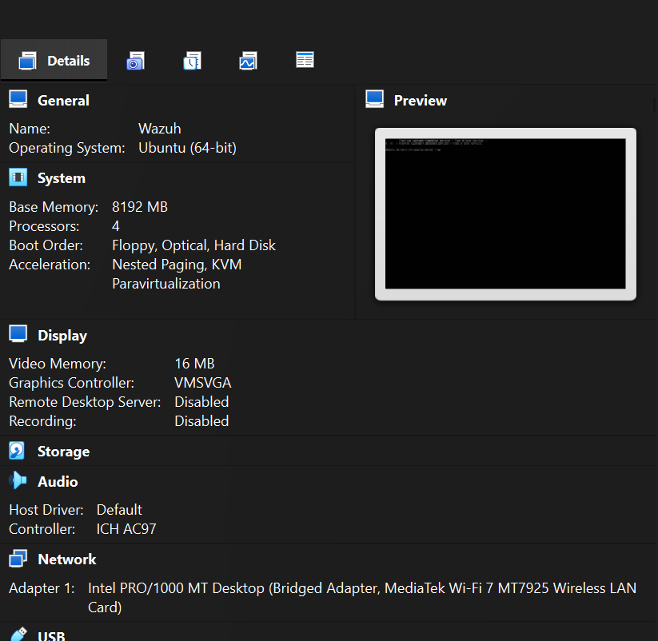

*Figure 1 — VirtualBox summary for the Wazuh server virtual machine.*

The Ubuntu terminal was then used to inspect the active network interfaces and assigned server address. The Wazuh agent deployment wizard later references `192.168.100.214` as the manager address.

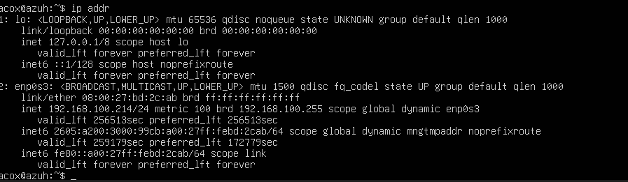

*Figure 2 — Ubuntu `ip addr` output used to check the server's network connectivity.*

### 2. Install Wazuh components

The screenshot of the Wazuh installation instructions shows the **Wazuh 4.14 installation assistant** and an all-in-one setup command. This is a record of the lab version, **not** a recommendation to use this specific version for new deployments.

```bash
# Command shown in the lab instructions; consult current docs before reuse.
curl -sO https://packages.wazuh.com/4.14/wazuh-install.sh
sudo bash ./wazuh-install.sh -a
```

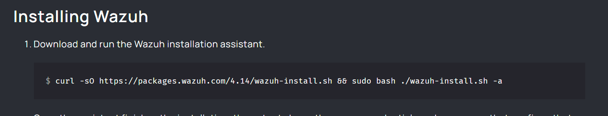

*Figure 3 — Installation assistant instructions captured during setup.*

The terminal subsequently displayed **“Installation finished”** and web interface access information. **Installer-generated account passwords have been redacted** in this repository copy.

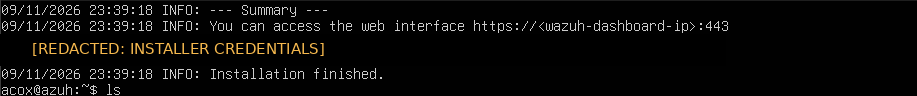

*Figure 4 — Installer completion confirmation, with credentials removed before publication.*

An additional terminal screenshot documents an Ubuntu package-source adjustment and `apt update` during setup/troubleshooting. The screenshot demonstrates the command sequence, not a general recommendation to remove repositories.

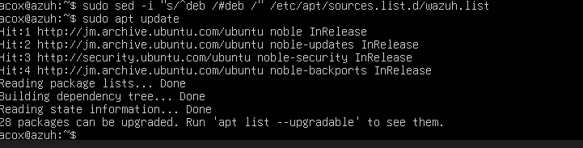

*Figure 5 — Ubuntu package repository and update check during the lab.*

### 3. Access the Wazuh dashboard

After installation, I accessed the Wazuh web login interface through the browser. The login screen establishes that the interface was reachable; the endpoint screenshots below provide stronger evidence of monitoring functionality.

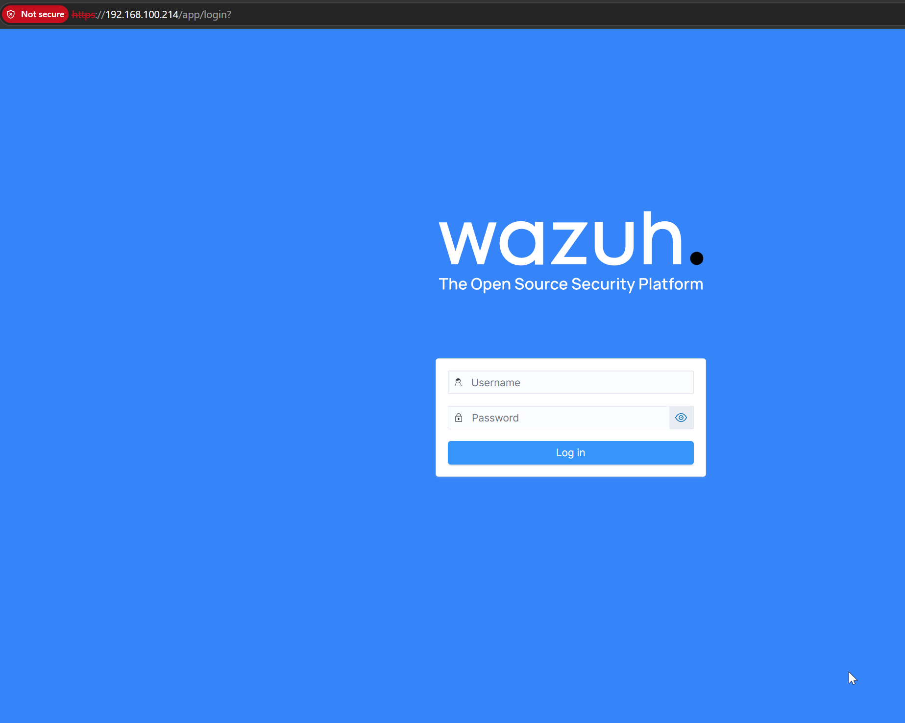

*Figure 6 — Wazuh security platform login interface.*

### 4. Deploy the Windows endpoint agent

Using **Deploy new agent**, I selected the Windows package, specified the Wazuh manager address, and assigned a Windows endpoint name. The Windows PowerShell screenshot shows installation via the Wazuh MSI and startup of the agent service.

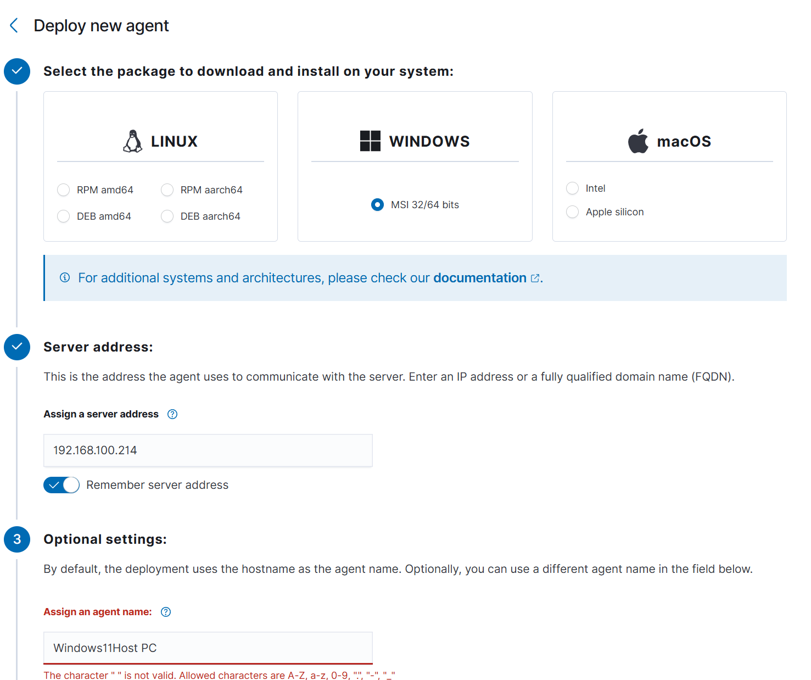

*Figure 7 — Windows agent package selection, manager address, and agent settings.*

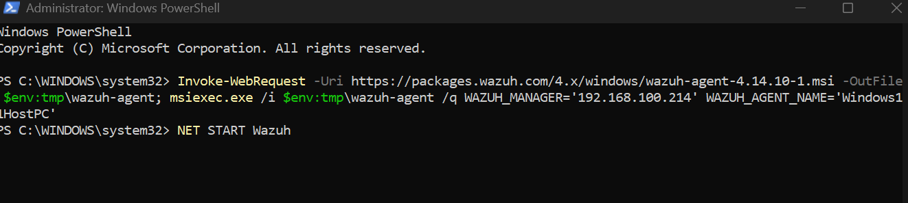

*Figure 8 — PowerShell installation command and `NET START Wazuh` service command.*

**Validation:** The `Windows11HostPC` device subsequently appears as **active** in Wazuh, with system inventory, events, compliance data, and vulnerability-detection widgets visible in its endpoint page.

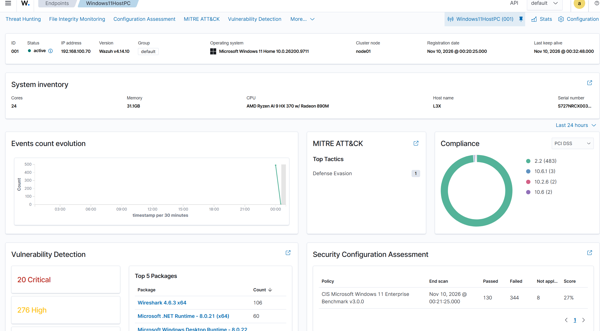

*Figure 9 — Registered Windows endpoint dashboard and telemetry overview.*

### 5. Prepare an additional Linux endpoint

The agent deployment workflow was also opened for **Linux**, with the **DEB amd64** package option and the Wazuh manager address selected. The configuration shown uses the agent name `KaliLinux`.

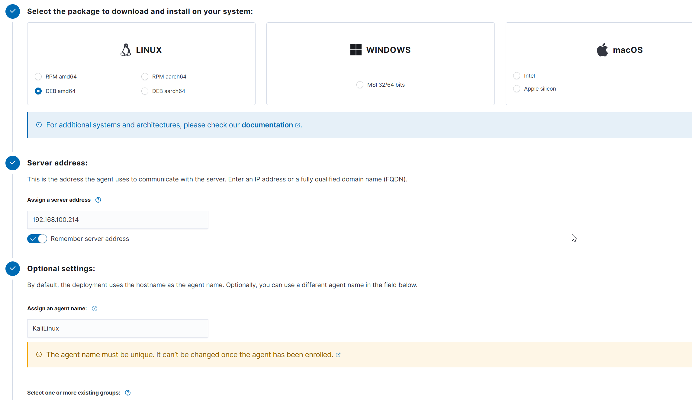

*Figure 10 — Wazuh Linux agent enrollment wizard prepared for the Kali Linux lab machine.*

**Evidence boundary:** This screenshot demonstrates preparation of a Linux agent command. It does **not** independently prove that the Kali agent installed successfully, connected, or sent events.

### 6. Review Windows endpoint telemetry and asset inventory

I used Wazuh's endpoint view to inspect basic host properties, system inventory, and event trends. The screenshot shows a Windows 11 endpoint with inventory values and security modules available for investigation.

Next, I reviewed the **IT Hygiene / Network** inventory. This view exposes host network information such as adapter names, addresses, and network-related values, supporting asset awareness and endpoint troubleshooting.

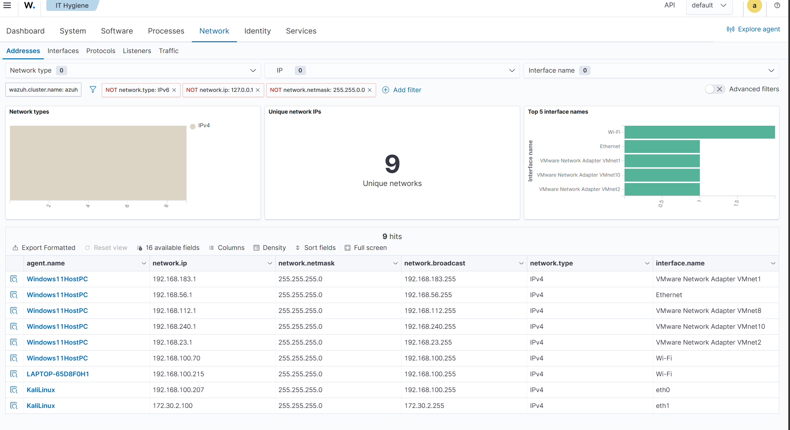

*Figure 11 — Wazuh endpoint network inventory for the enrolled Windows workstation.*

**SOC relevance:** Host context helps analysts understand *which device generated an event*, its network position, and whether an alert correlates with a relevant endpoint or interface.

### 7. Analyze vulnerability detection findings

The Wazuh Vulnerability Detection module produced a point-in-time dashboard of findings tied to the Windows endpoint's observed software and platform inventory.

In the captured snapshot, the severity counters show:

| Severity | Records shown |
| --- | ---: |
| Critical | 20 |
| High | 275 |
| Medium | 144 |
| Low | 8 |
| Pending evaluation | 0 |
| **Total across listed severities** | **447** |

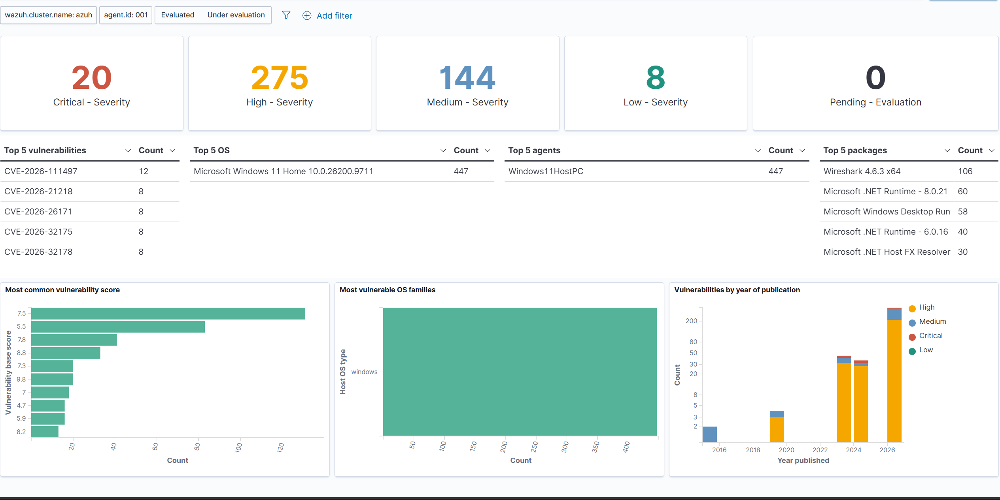

*Figure 12 — Wazuh vulnerability summary by severity, as displayed in the lab snapshot.*

I then examined the detailed results table, which lists the affected endpoint, software packages, installed versions, vulnerability descriptions, severity, and CVE references. The captured view displays **447 hits**.

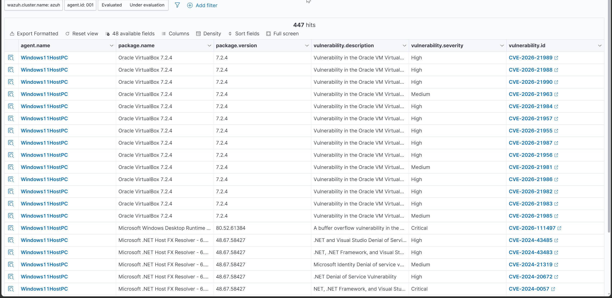

*Figure 13 — Detailed vulnerability detection records used for triage and prioritization.*

**Interpretation:** These counts represent **Wazuh detection records shown in the screenshot**, not 447 independently exploited vulnerabilities or proof that the environment was compromised. Version-based matches should be checked against vendor advisories and applicable configurations before remediation decisions.

### 8. Review File Integrity Monitoring configuration

I inspected a Windows `ossec.conf` configuration view showing **`syscheck`** settings, including monitored directories, a scan frequency, and real-time directory monitoring configuration. These are the types of settings used by Wazuh File Integrity Monitoring (FIM) to detect changes to selected paths.

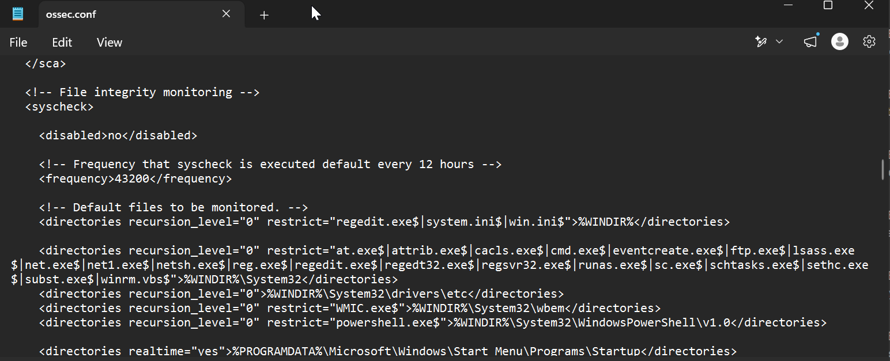

*Figure 14 — Endpoint `syscheck` settings used to configure file monitoring.*

**Evidence boundary:** The screenshot demonstrates FIM configuration; it does not show a corresponding file-change alert or establish that every configured path generated telemetry.

### 9. Configure VirusTotal enrichment and prepare a safe test

The Wazuh manager's `ossec.conf` shows a VirusTotal integration block with JSON alert formatting and alert threshold settings. The displayed API key value is a **placeholder** and should never be replaced with an active secret in a public repository.

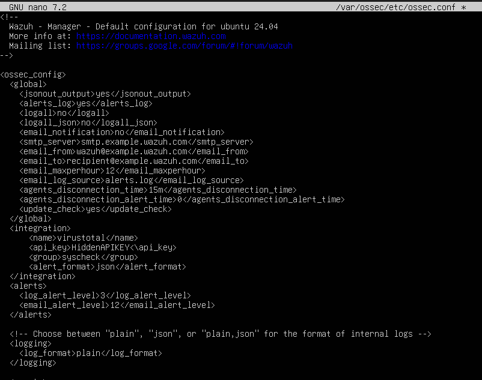

*Figure 15 — Wazuh manager configuration section for VirusTotal lookups and alert formatting.*

To produce a recognizable detection event safely, the Windows test environment included **EICAR antivirus test files**. EICAR is intended for security-tool validation and is **not actual malware**.

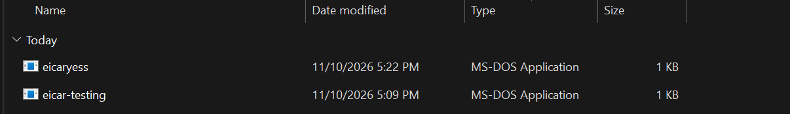

*Figure 16 — Files used for controlled EICAR testing on the Windows endpoint.*

### 10. Examine VirusTotal-enriched Wazuh event records

The final Wazuh screenshot shows VirusTotal integration event records associated with EICAR-named files on the Windows endpoint. The displayed event fields include:

- `agent.name`: `Windows11HostPC`
- `agent.ip`: `192.168.100.70`
- `data.integration`: `virustotal`
- `data.virustotal.found`: `1`
- `data.virustotal.total`: `68`
- `data.virustotal.positives`: `66`
- `data.virustotal.malicious`: `1`
- File metadata, hashes, and a VirusTotal permalink

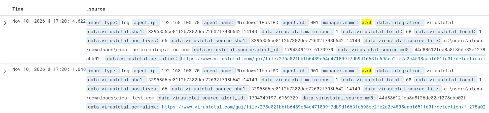

*Figure 17 — Wazuh event documents enriched with VirusTotal results for safe EICAR test samples.*

**Finding:** The screenshot provides evidence that **VirusTotal-enriched records were visible in Wazuh** for the test sample. It does **not** prove a real malicious intrusion, automated file quarantine, or a completed incident-response action.

---

## Results Summary

| Control / capability | What the screenshots demonstrate | Confidence |
| --- | --- | --- |
| Wazuh VM infrastructure | VirtualBox Wazuh Ubuntu VM configured | Observed |
| Wazuh server installation | Successful installation message and reachable web UI | Observed |
| Windows agent deployment | PowerShell setup plus active Windows endpoint in dashboard | Observed |
| Linux agent deployment | Agent package/manager configuration in deployment wizard | Prepared; connected status not verified |
| Endpoint inventory | Windows host profile and network inventory present | Observed |
| Vulnerability Detection | Severity dashboard and 447 matching findings records at capture time | Observed; findings not manually validated |
| File Integrity Monitoring | `syscheck` configuration paths and scan behavior | Config shown; alert validation not shown |
| VirusTotal enrichment | Wazuh integration event fields for safe EICAR test samples | Observed |
| Automated containment | No proof of automatic isolation or remediation | Not claimed |

## Troubleshooting and Operational Considerations

| Area | Check or lesson |
| --- | --- |
| Wazuh manager connectivity | Confirm the manager IP is reachable from the endpoint and firewall permits required connections. |
| Agent enrollment | Verify the device appears in the agent list as active before claiming successful ingestion. |
| Log visibility | Use agent filters, time ranges, and event index fields to confirm expected telemetry. |
| Vulnerability counts | Treat findings as triage input; inspect affected packages, versions, and CVEs. |
| FIM | Verify watched paths and make a harmless, reversible file change before claiming an alert. |
| VirusTotal | Keep active API credentials out of screenshots, Git history, and public `ossec.conf`. |
| EICAR testing | Use only approved test environments; EICAR is a harmless test string, not live malware. |

## Key Takeaways

This lab strengthened my understanding of how a centralized monitoring platform can connect **endpoint visibility**, **software risk awareness**, **configuration monitoring**, and **external threat intelligence** into one investigation workflow.

The most useful lessons were distinguishing enrolled endpoints from merely configured agents, reading vulnerability findings critically, and validating integrations using **safe, controlled test artifacts**.

## Evidence Index

The exact origin of each image is documented in [`SCREENSHOT-GUIDE.md`](SCREENSHOT-GUIDE.md). All images in this repository were extracted from my *Cyber Home Lab Doc 1.docx* and are referenced using local relative paths in `screenshots/`.

**Security note:** Installation output originally contained Wazuh-generated passwords. The published installation screenshot has been cropped and redacted to prevent accidental credential disclosure. Credentials associated with any live deployment should be rotated before publishing evidence from an installation.

## References

- [Wazuh Documentation](https://documentation.wazuh.com/current/)
- [Wazuh Agent Deployment](https://documentation.wazuh.com/current/installation-guide/wazuh-agent/index.html)
- [Wazuh File Integrity Monitoring](https://documentation.wazuh.com/current/user-manual/capabilities/file-integrity/index.html)
- [Wazuh Vulnerability Detection](https://documentation.wazuh.com/current/user-manual/capabilities/vulnerability-detection/index.html)
- [VirusTotal](https://www.virustotal.com/)
- [EICAR Antivirus Test File](https://www.eicar.org/download-anti-malware-testfile/)

---

**Portfolio:** [KerberosAC](https://github.com/KerberosAC) · [LinkedIn](https://www.linkedin.com/in/alexandercox25/)
